# -Spam-Email-Classification-using-NLP-and-Machine-Learning
<h1>SpamClassifier</h1>

SpamClassifier is a simple yet effective tool that uses Machine Learning and NLP to identify and filter spam emails.

<h1>Features:</h1>

1. Email Classification:
Quickly classify emails as "Spam" or "Not Spam."
When you enter an email 

2. Performance Metrics:
Check accuracy, confusion matrix, and classification report to understand the model's performance.

3. Easy-to-Use Interface:
Built with Streamlit, the tool displays results with a clear color-coded background: Pink for Spam and Purpul for Not Spam.

---

## 🏗️ System Architecture

The runtime loads the saved vectorizer and classifier, transforms the submitted text, and displays the prediction. Training is explored separately in the notebook; the Streamlit application performs inference.

```mermaid
flowchart LR
    A["Email text"] --> B["Streamlit interface"]
    B --> C["Saved vectorizer: vec.pkl"]
    C --> D["Saved classifier: spam.pkl"]
    D --> E["Spam or not-spam result"]
    class A entry
    class B,C,D process
    class E output
    classDef entry fill:#EAF2FF,stroke:#5275AD,color:#1E3556
    classDef process fill:#F0EBFA,stroke:#8870B2,color:#3B2856
    classDef system fill:#FFF2DA,stroke:#AA8440,color:#51401E
    classDef output fill:#E3F4EC,stroke:#4C8A72,color:#234C3B
    classDef pending fill:#F8E9E7,stroke:#AD706A,color:#653C37,stroke-dasharray:5 5
```

<strong>Follow the implementation</strong>

| Stage | Source |
| --- | --- |
| Prediction interface | [app.py](app.py) |
| Training exploration | [Spam Detector.ipynb](Spam%20Detector.ipynb) |

## About the developer

Built by **Pallavi Vholgade**. Explore my AI / ML projects, experience, and skills in my [portfolio](https://pallavi-portfolio-preview.vercel.app).

[LinkedIn](https://www.linkedin.com/in/pallavi-vholgade-05565b24b) · [Email](mailto:pallavivhalgade@gmail.com)
